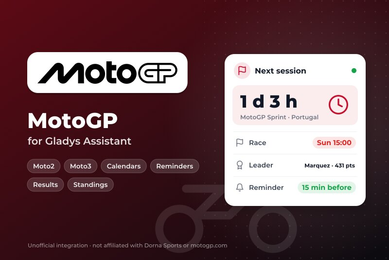
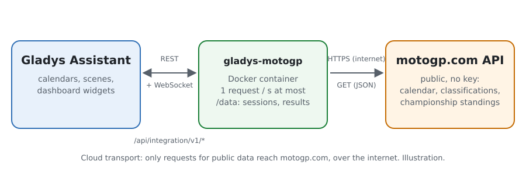
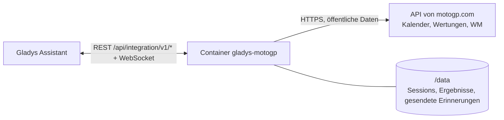
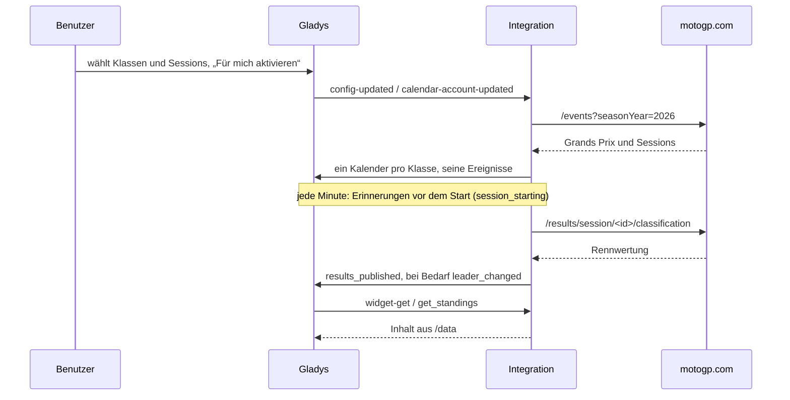
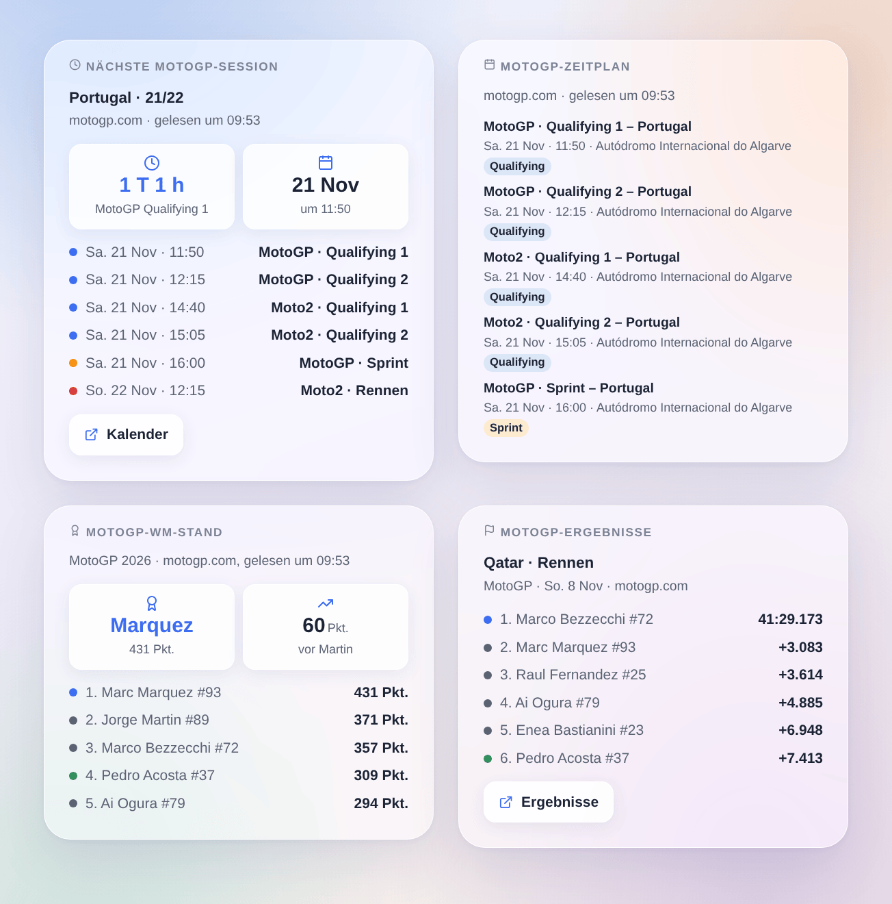

# Gladys MotoGP

[English](README.md) · [Français](README.fr.md) · **Deutsch** · [Español](README.es.md)

[](LICENSE)
[](https://github.com/William-De71/gladys-motogp/releases)
[](https://github.com/William-De71/gladys-motogp/actions/workflows/release.yml)
[](https://gladysassistant.com)



Eine externe Integration für [Gladys Assistant](https://gladysassistant.com), um die **MotoGP-Weltmeisterschaft** zu verfolgen: Die Sessions von MotoGP, Moto2 und Moto3 kommen in den Gladys-Kalender, mit den Ergebnissen und dem WM-Stand. Szenen können vor dem Start den Fernseher einschalten oder den Sieg Ihres Fahrers feiern, und vier Widgets zeigen, was ansteht.

Benutzerdokumentation: [English](docs/en.md) · [Français](docs/fr.md) · [Deutsch](docs/de.md) · [Español](docs/es.md).

> Inoffizielle Community-Integration, nicht verbunden mit, unterstützt oder gesponsert von Dorna Sports, der FIM oder motogp.com. MotoGP ist eine Marke von Dorna Sports.

## Funktionen

- **4 Klassen** zur Auswahl: MotoGP, Moto2, Moto3 und der Bagger World Cup (nur Kalender).
- **6 Arten von Sessions**, jede abwählbar: Rennen, Sprints, Qualifying, Training, Warm-up, Tests außerhalb der Grands Prix.
- **Ein Kalender pro Klasse** für jeden Benutzer, der die Integration unter „Meine Kalender“ aktiviert, die laufende und die nächste Saison, in der Sprache jedes Benutzers.
- **Ergebnisse** der Rennen, Sprints und Qualifyings und der **WM-Stand**, Ihre **Lieblingsfahrer** hervorgehoben.
- **3 Szenenauslöser**, **3 Szenenaktionen** und **4 Dashboard-Widgets** (siehe unten).
- Kein Konto, kein Schlüssel. Überall vier Sprachen: Englisch, Französisch, Deutsch, Spanisch.

## Funktionsweise





Die Daten stammen von der öffentlichen API hinter [motogp.com](https://www.motogp.com) und seinen offiziellen Apps, ohne Schlüssel. Die Integration geht schonend damit um: eine Anfrage nach der anderen, eine Sekunde Abstand, einige Dutzend am Tag.

- **Kalender**: alle 6 Stunden, alle 30 Minuten an einem Grand-Prix-Wochenende (die Zeiten ändern sich mit dem Wetter); die nächste Saison ab September einmal am Tag.
- **Ergebnisse**: eines Rennens, eines Sprints oder von Q2, 3 Minuten nach dem geschätzten Ende, dann 3 Stunden lang alle 5 Minuten, dann stündlich.
- **WM**: zweimal am Tag und direkt nach einem Rennen oder Sprint.



### Transport

Nur Cloud (`"transports": ["cloud"]`): Der Katalog zeigt das Cloud-Abzeichen. Nur Anfragen nach öffentlichen Daten (Saison, Session, Klasse) gehen an `api.motogp.pulselive.com`. Nichts über Sie oder Ihr Zuhause verlässt Ihr Netzwerk. Es gibt keinen lokalen Weg, daher keine Schaltfläche „Lokale Verbindung bevorzugen“.

## Kalender und Ereignisse

Keine Geräte: Gladys erlaubt einer Integration nicht, zugleich Kalender- und Geräte-Integration zu sein. Jede verfolgte Klasse ist ein Kalender, für jeden Benutzer, der die Integration aktiviert hat.

| Element      | Inhalt                                                                                         |
| ------------ | ---------------------------------------------------------------------------------------------- |
| Kalender     | „MotoGP“, „Moto2“ …, Farbe der Klasse, privat, bis Sie ihn teilen                              |
| Ereignis     | Eine Session zur Uhrzeit von Gladys; das Ende eines Rennens ist geschätzt (45 Min., Sprint 25) |
| Titel        | „MotoGP · Sprint – Portugal“, in der Sprache des Benutzers                                     |
| Ort          | Strecke, Stadt und Land                                                                        |
| Beschreibung | Der offizielle Name des Grand Prix, der Lauf, die Quelle                                       |
| Link         | Der Kalender von motogp.com                                                                    |

Das Fenster reicht von 14 Tagen zurück bis zum Ende der nächsten Saison, sobald sie veröffentlicht ist. Unter „Meine Kalender“ kann jeder Benutzer die Synchronisierung eines Kalenders beenden oder ihn **mit dem Haushalt teilen**: Nur ein geteilter Kalender erreicht die Szenen des Haushalts und den eingebauten Auslöser „Ein Kalenderereignis steht bevor“.

## Szenenauslöser, -aktionen und Widgets



**Szenenauslöser** (einmal pro Übergang; das allererste Lesen meldet nichts):

- **Eine Session beginnt**: beim Start oder 15, 30, 60 oder 120 Minuten vorher. Filter: Klassen, Sessions, „Wann“.
- **Ergebnisse veröffentlicht**: Rennen, Sprint oder Qualifying (Startaufstellung). Filter: Klassen, Sessions, Ergebnis meines Lieblingsfahrers (gewinnt, Podium, Top 10, dahinter, nicht gewertet, abwesend).
- **Neuer WM-Führender**. Filter: Klassen.

Variablen: `title`, `category`, `category_name`, `session`, `session_name`, `grand_prix`, `round`, `circuit`, `date`, `time` …; `winner_name`, `winner_number`, `winner_team`, `second_name`, `third_name`, `podium`, `favorite_name`, `favorite_position`, `favorite_points`, `favorite_result`, `text` für die Ergebnisse; `leader_name`, `leader_points`, `gap_to_second`, `previous_leader_name` für den Führenden.

**Szenenaktionen**: **nächste Session**, **WM-Stand** (Top 3, Platz und Rückstand Ihres Favoriten) und **letzte Ergebnisse** (Podium, Ergebnis Ihres Favoriten), jeweils mit einem fertigen Satz `text`.

**Widgets**: **Nächste MotoGP-Session** (Countdown, Tag, Uhrzeit und der Rest des Wochenendes), **MotoGP-Zeitplan** (3, 5 oder 8 Sessions), **MotoGP-WM-Stand** (Führender, Abstand, Top 5 oder 10) und **MotoGP-Ergebnisse** (letztes Rennen, Sprint oder Qualifying mit den Abständen). Favoriten sind grün.

Beispiele:

- Wenn **das MotoGP-Rennen in 15 Minuten beginnt** → Fernseher einschalten, das Wohnzimmerlicht dimmen.
- Wenn **die Ergebnisse da sind** und **mein Favorit gewinnt** → grünes Licht und `{{triggerEvent.data.text}}` per Telegram.
- Jeden Montag um 8 Uhr → **WM-Stand**, dann `{{text}}` senden.

## Voraussetzungen

- Gladys Assistant **5.3.0** oder neuer (Kalender-Integrationen; Katalog-Schlüsselwörter von Gladys 5.3). Ältere Instanzen können die Integration nicht installieren.
- Internetzugang. Kein Konto, kein Schlüssel.

## Installation

- **Aus dem Gladys-Store** (Integrationen → Externe Integrationen), mit einem Klick, sobald indexiert.
- **Über die URL des Repositorys**: `https://github.com/William-De71/gladys-motogp`.
- **Entwicklermodus**: Bauen Sie das Image lokal (`docker build -t gladys-motogp .`) und installieren Sie es aus Gladys.

## Konfiguration

| Feld                       | Beschreibung                                                                    |
| -------------------------- | ------------------------------------------------------------------------------- |
| Klassen                    | MotoGP (Standard), Moto2, Moto3, Bagger World Cup. Je ein Kalender.             |
| Sessions                   | Standardmäßig Rennen, Sprints und Qualifying; dazu Training, Warm-up und Tests. |
| Lieblingsfahrer (optional) | Startnummern oder Namen, durch Kommas getrennt: „93, Bezzecchi“.                |
| Sprache der Szenentexte    | Automatisch (die Sprache des Dashboards) oder fest, für die Sätze `text`.       |

Drücken Sie dann unter **Meine Kalender** auf derselben Seite auf **Für mich aktivieren**: Jeder Benutzer, der die Kalender möchte, aktiviert die Integration für sich selbst.

## Verwendung

1. Wählen Sie die Klassen, die Sessions und Ihre Lieblingsfahrer und speichern Sie.
2. Drücken Sie unter **Meine Kalender** auf **Für mich aktivieren**; teilen Sie die Kalender mit dem Haushalt, um sie in Szenen zu nutzen.
3. Fügen Sie die Widgets einem Dashboard hinzu und erstellen Sie Szenen mit den Auslösern oben.

## Entwicklung

```bash
npm install
npm test                       # node --test, nie mit dem Netzwerk
npm run lint && npm run format:check
npx github:GladysAssistant/integration-store . --skip-image-check
scripts/build-cover.sh         # cover.jpg aus docs/assets/cover.svg
docs/illustrations/render.sh   # docs/assets/widgets.<sprache>.png
node .github/scripts/release.mjs next
```

Lokal liest das SDK `GLADYS_HOST_API_URL`, `GLADYS_INTEGRATION_TOKEN` und `GLADYS_INTEGRATION_SELECTOR`, und `TZ` legt die Zeitzone der angezeigten Uhrzeiten fest; `DEBUG=gladys-integration-sdk` zeigt die Logs des SDK und prüft jeden Widget-Inhalt. Die Tests nutzen echte, gekürzte Antworten von motogp.com (`test/fixtures/`). Die Projektregeln stehen in [CLAUDE.md](CLAUDE.md).

## Release-Prozess


Jeder Merge auf `main` startet die CI und berechnet dann die Version aus den [Conventional Commits](https://www.conventionalcommits.org/de/) seit dem letzten Tag: `feat` → Minor, `fix` / `perf` → Patch, `!` oder `BREAKING CHANGE` → Major (vor 1.0.0 ein Minor); `docs`, `chore`, `ci`, `test`, `style`, `refactor`, `build` allein veröffentlichen nichts. Der Changelog-Abschnitt wird erzeugt, das Tag gepusht, das Multi-Arch-Image gebaut, dann erhält `main` den Release-Commit, die GitHub Release wird erstellt und ein letzter Job prüft das öffentliche Image, den Store-Validator und das Topic.

- Der Titel des Pull Requests wird zum Squash-Commit und dann zur Changelog-Zeile: Schreiben Sie ihn auf Englisch, für den Benutzer (`pr-title.yml` prüft ihn). Bearbeiten Sie `CHANGELOG.md` nie von Hand.
- 1.0.0 ist eine Entscheidung: Actions → Release → Run workflow mit `release-as: 1.0.0`. `dry-run` zeigt Version und Notizen, ohne etwas zu veröffentlichen.
- **Geschützter Branch**: Rulesets verlangen einen Pull Request auf `main` und sperren die `v*`-Tags; nur der Maintainer und Deploy Keys kommen durch. Das Release pusht mit dem Deploy Key der Umgebung `release` (Secret `RELEASE_DEPLOY_KEY`, nur `main`): Ein Lauf von einem anderen Branch erhält ihn nie. `build.yml` und `github-release.yml` starten nicht bei einem Tag: Das Release ruft sie auf, oder starten Sie sie von Hand (Actions → Run workflow, mit `version` für das Image), um ein Release abzuschließen.
- Machen Sie nach der ersten Release das Paket auf `ghcr.io` öffentlich (Package settings → Change visibility), sonst kann Gladys es nicht laden.

## Fehlerbehebung

Siehe [docs/de.md](docs/de.md#fehlerbehebung). Melden Sie ein Problem mit den Versionen von Gladys und der Integration, den verfolgten Klassen und den Zeilen des Reiters Logs.

## Mitwirken

Issues und Pull Requests sind willkommen. Führen Sie vor einem Pull Request `npm run format:check && npm run lint && npm test` aus und ändern Sie nie eine externe ID oder einen gespeicherten Schlüssel (siehe [CLAUDE.md](CLAUDE.md)).

## Sicherheit

Siehe [SECURITY.md](SECURITY.md): Melden Sie Schwachstellen vertraulich. Die Integration hat kein Geheimnis; sie läuft schreibgeschützt, ohne Root-Rechte, in ihrem Container und kontaktiert nur die API von motogp.com.

## Kommende Screenshots

Die Bilder oben sind Illustrationen, keine Screenshots. Echte Screenshots kommen nach `docs/assets/screenshots/` (PNG, 1280 × 800): `configuration.png`, `my-calendars.png`, `calendar.png`, `scene.png`.

## Lizenz

[Apache-Lizenz 2.0](LICENSE) — siehe auch [NOTICE](NOTICE). Die Daten stammen von [motogp.com](https://www.motogp.com): Widgets und Ereignisse nennen ihre Quelle. Danke an die Dokumentation und das SDK von Gladys.
