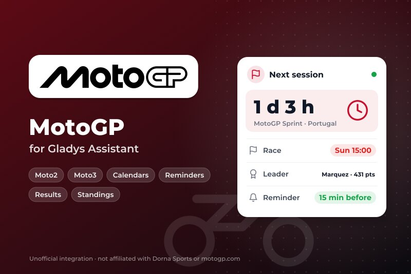
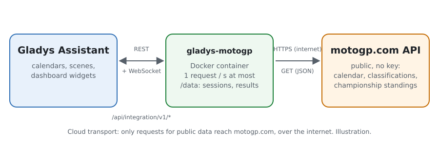
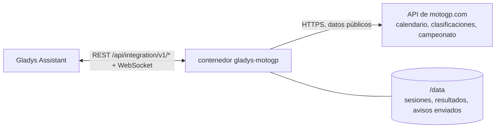
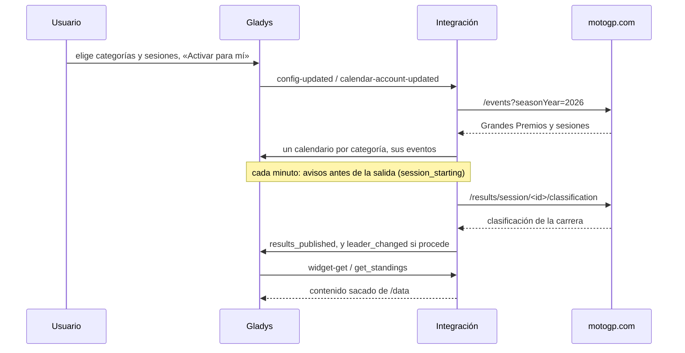
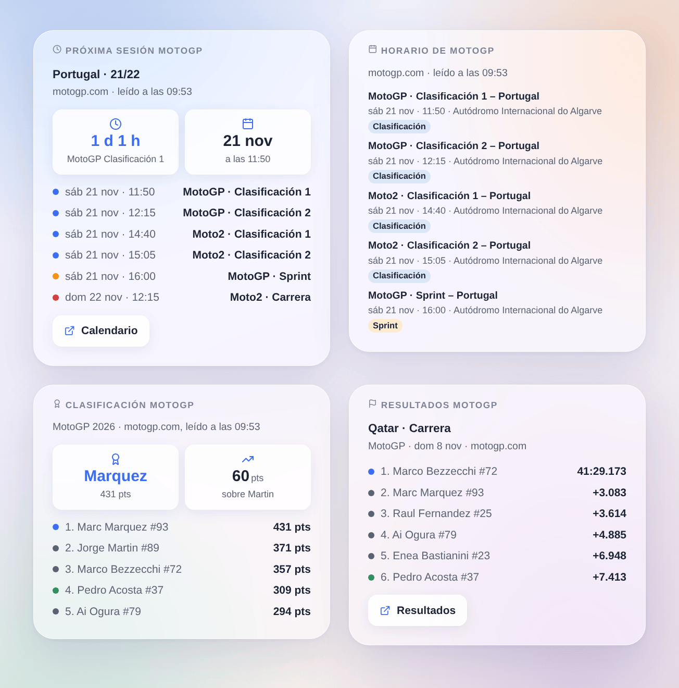

# Gladys MotoGP

[English](README.md) · [Français](README.fr.md) · [Deutsch](README.de.md) · **Español**

[](LICENSE)
[](https://github.com/William-De71/gladys-motogp/releases)
[](https://github.com/William-De71/gladys-motogp/actions/workflows/release.yml)
[](https://gladysassistant.com)



Una integración externa de [Gladys Assistant](https://gladysassistant.com) para seguir el **Campeonato del Mundo de MotoGP**: las sesiones de MotoGP, Moto2 y Moto3 llegan al calendario de Gladys, con los resultados y la clasificación del campeonato. Las escenas pueden encender la tele antes de la salida o celebrar la victoria de su piloto, y cuatro widgets muestran lo que viene.

Documentación de usuario: [English](docs/en.md) · [Français](docs/fr.md) · [Deutsch](docs/de.md) · [Español](docs/es.md).

> Integración comunitaria no oficial, sin relación con Dorna Sports, la FIM ni motogp.com, ni respaldada por ellos. MotoGP es una marca de Dorna Sports.

## Funciones

- **4 categorías** a elegir: MotoGP, Moto2, Moto3 y la Bagger World Cup (solo calendario).
- **6 tipos de sesiones**, cada uno puede descartarse: carreras, sprints, clasificación, entrenamientos, warm up, tests fuera de los Grandes Premios.
- **Un calendario por categoría** para cada usuario que activa la integración en «Mis calendarios», la temporada actual y la siguiente, en el idioma de cada uno.
- **Resultados** de las carreras, sprints y clasificaciones, y la **clasificación del campeonato**, con sus **pilotos favoritos** destacados.
- **3 disparadores de escena**, **3 acciones de escena** y **4 widgets** del panel (abajo).
- Sin cuenta ni clave. Cuatro idiomas en todas partes: inglés, francés, alemán, español.

## Funcionamiento





Los datos proceden de la API pública que hay detrás de [motogp.com](https://www.motogp.com) y de sus aplicaciones oficiales, sin clave. La integración la trata con cuidado: una petición cada vez, con un segundo de separación, unas decenas al día.

- **Calendario**: cada 6 horas, cada 30 minutos durante un fin de semana de Gran Premio (los horarios cambian con el tiempo); la temporada siguiente una vez al día a partir de septiembre.
- **Resultados**: de una carrera, un sprint o la Q2, 3 minutos después del fin estimado, luego cada 5 minutos durante 3 horas y después cada hora.
- **Campeonato**: dos veces al día, y justo después de una carrera o un sprint.



### Transporte

Solo nube (`"transports": ["cloud"]`): el catálogo muestra la insignia de nube. Solo salen hacia `api.motogp.pulselive.com` peticiones de datos públicos (temporada, sesión, categoría). Nada sobre usted ni su casa sale de su red. No hay camino local, así que no hay botón «Preferir la conexión local».

## Calendarios y eventos

Sin dispositivos: Gladys no permite que una integración sea a la vez de tipo calendario y de dispositivos. Cada categoría seguida es un calendario, para cada usuario que activó la integración.

| Elemento    | Contenido                                                                                |
| ----------- | ---------------------------------------------------------------------------------------- |
| Calendario  | «MotoGP», «Moto2»…, color de la categoría, privado hasta que lo comparta                 |
| Evento      | Una sesión, a la hora de Gladys; el fin de una carrera se estima (45 min, sprint 25 min) |
| Título      | «MotoGP · Sprint – Portugal», en el idioma del usuario                                   |
| Lugar       | Circuito, ciudad y país                                                                  |
| Descripción | El nombre oficial del Gran Premio, la ronda, la fuente                                   |
| Enlace      | El calendario de motogp.com                                                              |

La ventana va desde hace 14 días hasta el final de la temporada siguiente en cuanto se publica. En «Mis calendarios», cada usuario puede detener la sincronización de un calendario o **compartirlo con el hogar**: solo un calendario compartido llega a las escenas del hogar y al disparador nativo «Se acerca un evento del calendario».

## Disparadores, acciones de escena y widgets



**Disparadores de escena** (una vez por transición; la primera lectura no anuncia nada):

- **Empieza una sesión**: en la salida, o 15, 30, 60 o 120 minutos antes. Filtros: categorías, sesiones, «Cuándo».
- **Resultados publicados**: carrera, sprint o clasificación (parrilla). Filtros: categorías, sesiones, resultado de mi piloto favorito (gana, podio, top 10, más atrás, no clasificado, ausente).
- **Nuevo líder del campeonato**. Filtro: categorías.

Variables: `title`, `category`, `category_name`, `session`, `session_name`, `grand_prix`, `round`, `circuit`, `date`, `time`…; `winner_name`, `winner_number`, `winner_team`, `second_name`, `third_name`, `podium`, `favorite_name`, `favorite_position`, `favorite_points`, `favorite_result`, `text` para los resultados; `leader_name`, `leader_points`, `gap_to_second`, `previous_leader_name` para el líder.

**Acciones de escena**: **próxima sesión**, **clasificación del campeonato** (top 3, posición y desventaja de su favorito) y **últimos resultados** (podio, resultado de su favorito), cada una con una frase lista `text`.

**Widgets**: **Próxima sesión MotoGP** (cuenta atrás, día, hora y el resto del fin de semana), **Horario de MotoGP** (3, 5 u 8 sesiones), **Clasificación MotoGP** (líder, diferencia, top 5 o 10) y **Resultados MotoGP** (última carrera, sprint o clasificación, con las diferencias). Los favoritos van en verde.

Ejemplos:

- Cuando **la carrera de MotoGP empiece en 15 minutos** → encender la tele, atenuar las luces del salón.
- Cuando **se publiquen los resultados** y **gane mi favorito** → luces en verde y `{{triggerEvent.data.text}}` por Telegram.
- Cada lunes a las 8:00 → **clasificación del campeonato** y enviar `{{text}}`.

## Requisitos

- Gladys Assistant **5.3.0** o posterior (integraciones de tipo calendario; palabras clave del catálogo de Gladys 5.3). Las instancias más antiguas no pueden instalar la integración.
- Acceso a internet. Ninguna cuenta, ninguna clave.

## Instalación

- **Desde la tienda de Gladys** (Integraciones → Integraciones externas), con un clic, una vez indexada.
- **Desde la URL del repositorio**: `https://github.com/William-De71/gladys-motogp`.
- **Modo desarrollador**: construya la imagen en local (`docker build -t gladys-motogp .`) e instálela desde Gladys.

## Configuración

| Campo                               | Descripción                                                                            |
| ----------------------------------- | -------------------------------------------------------------------------------------- |
| Categorías                          | MotoGP (por defecto), Moto2, Moto3, Bagger World Cup. Un calendario cada una.          |
| Sesiones                            | Carreras, sprints y clasificación por defecto; además entrenamientos, warm up y tests. |
| Pilotos favoritos (opcional)        | Dorsales o nombres separados por comas: «93, Bezzecchi».                               |
| Idioma de los textos de las escenas | Automático (el idioma del panel) o uno fijo, para las frases `text`.                   |

Después, en **Mis calendarios** en la misma página, pulse **Activar para mí**: cada usuario que quiera los calendarios activa la integración para sí mismo.

## Uso

1. Elija las categorías, las sesiones y sus pilotos favoritos, y guarde.
2. En **Mis calendarios**, pulse **Activar para mí**; comparta los calendarios con el hogar para usarlos en escenas.
3. Añada los widgets a un panel y cree escenas con los disparadores de arriba.

## Desarrollo

```bash
npm install
npm test                       # node --test, sin tocar nunca la red
npm run lint && npm run format:check
npx github:GladysAssistant/integration-store . --skip-image-check
scripts/build-cover.sh         # cover.jpg a partir de docs/assets/cover.svg
docs/illustrations/render.sh   # docs/assets/widgets.<idioma>.png
node .github/scripts/release.mjs next
```

En local, el SDK lee `GLADYS_HOST_API_URL`, `GLADYS_INTEGRATION_TOKEN` y `GLADYS_INTEGRATION_SELECTOR`, y `TZ` fija la zona horaria de las horas mostradas; `DEBUG=gladys-integration-sdk` muestra los registros del SDK y comprueba cada contenido de widget. Las pruebas usan respuestas reales de motogp.com, reducidas (`test/fixtures/`). Las reglas del proyecto están en [CLAUDE.md](CLAUDE.md).

## Proceso de release


Cada fusión en `main` lanza la CI y calcula la versión a partir de los [Conventional Commits](https://www.conventionalcommits.org/es/) desde la última etiqueta: `feat` → menor, `fix` / `perf` → parche, `!` o `BREAKING CHANGE` → mayor (una menor antes de 1.0.0); `docs`, `chore`, `ci`, `test`, `style`, `refactor`, `build` solos no publican nada. Se genera la sección del changelog, se sube la etiqueta, se construye la imagen multiarquitectura, `main` recibe el commit de release, se crea la GitHub Release y un último job comprueba la imagen pública, el validador de la tienda y el topic.

- El título del pull request se convierte en el commit de squash y luego en la línea del changelog: escríbalo en inglés, para el usuario (`pr-title.yml` lo comprueba). No edite nunca `CHANGELOG.md` a mano.
- La 1.0.0 es una decisión: Actions → Release → Run workflow con `release-as: 1.0.0`. `dry-run` muestra la versión y las notas sin publicar nada.
- **Rama protegida**: unos rulesets exigen una pull request en `main` y bloquean las etiquetas `v*`; solo pasan el mantenedor y las deploy keys. La publicación hace push con la deploy key del entorno `release` (secreto `RELEASE_DEPLOY_KEY`, solo `main`): una ejecución lanzada desde otra rama nunca la obtiene. `build.yml` y `github-release.yml` no arrancan con una etiqueta: la publicación los llama, o lánzelos a mano (Actions → Run workflow, con `version` para la imagen) para terminar una publicación.
- Tras la primera release, haga público el paquete de `ghcr.io` (Package settings → Change visibility); si no, Gladys no puede descargarlo.

## Solución de problemas

Vea [docs/es.md](docs/es.md#solución-de-problemas). Informe de un problema con las versiones de Gladys y de la integración, las categorías seguidas y las líneas de la pestaña Registros.

## Contribuir

Issues y pull requests son bienvenidos. Ejecute `npm run format:check && npm run lint && npm test` antes de abrir un pull request y no cambie ningún identificador externo ni ninguna clave guardada (vea [CLAUDE.md](CLAUDE.md)).

## Seguridad

Vea [SECURITY.md](SECURITY.md): informe de las vulnerabilidades en privado. La integración no tiene ningún secreto; funciona en solo lectura, sin derechos de root, en su contenedor, y solo contacta con la API de motogp.com.

## Capturas pendientes

Las imágenes de arriba son ilustraciones, no capturas de pantalla. Las capturas reales irán en `docs/assets/screenshots/` (PNG, 1280 × 800): `configuration.png`, `my-calendars.png`, `calendar.png`, `scene.png`.

## Licencia

[Licencia Apache 2.0](LICENSE) — vea también [NOTICE](NOTICE). Los datos proceden de [motogp.com](https://www.motogp.com): los widgets y los eventos indican su fuente. Gracias a la documentación y al SDK de Gladys.
