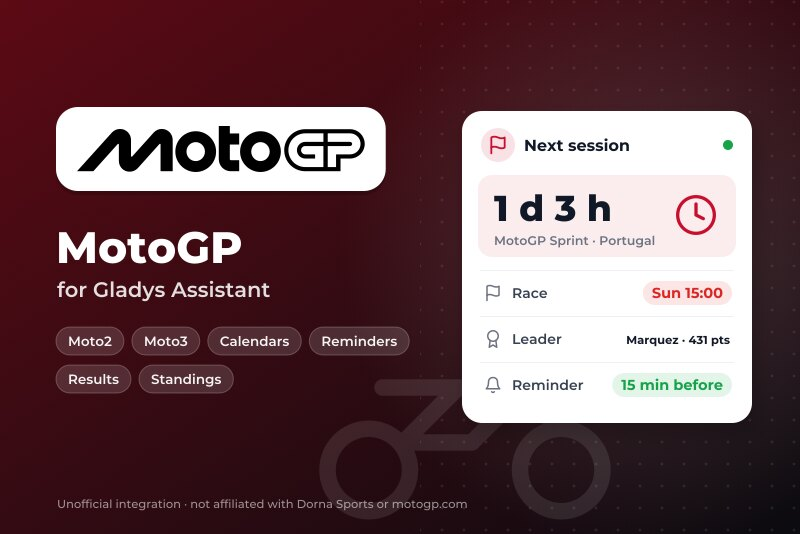
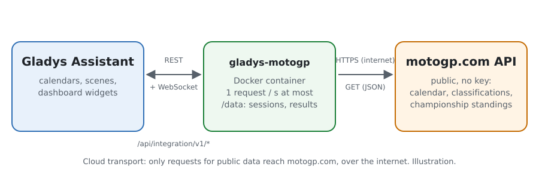
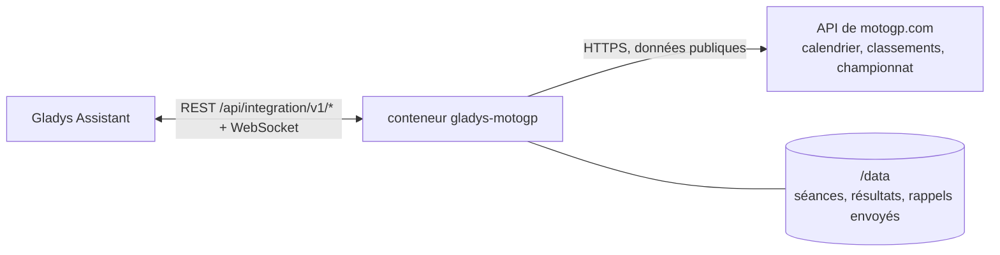
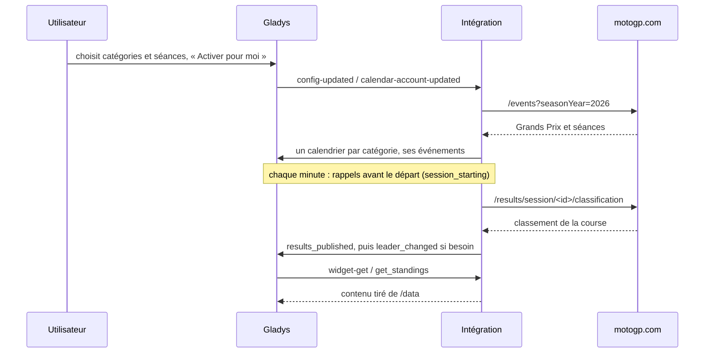
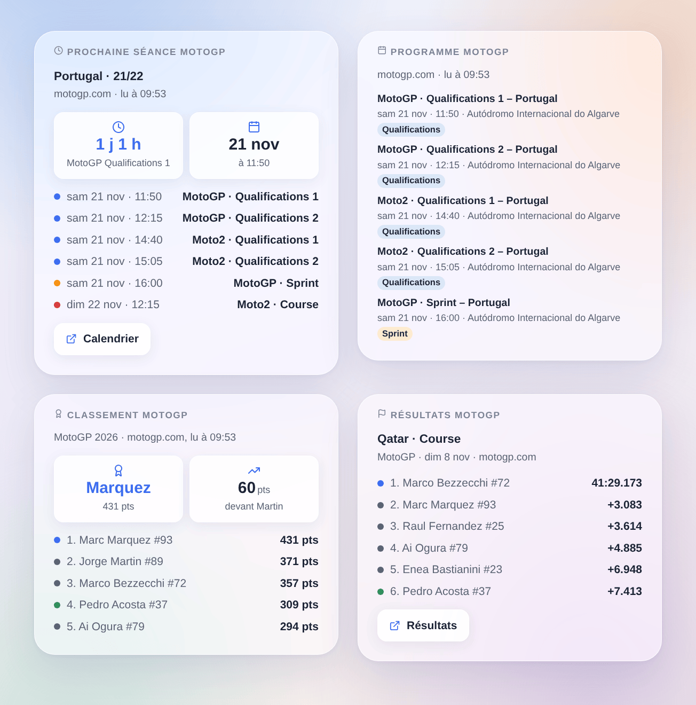

# Gladys MotoGP

[English](README.md) · **Français** · [Deutsch](README.de.md) · [Español](README.es.md)

[](LICENSE)
[](https://github.com/William-De71/gladys-motogp/releases)
[](https://github.com/William-De71/gladys-motogp/actions/workflows/release.yml)
[](https://gladysassistant.com)



Une intégration externe de [Gladys Assistant](https://gladysassistant.com) pour suivre le **championnat du monde MotoGP** : les séances de MotoGP, Moto2 et Moto3 arrivent dans le calendrier de Gladys, avec les résultats et le classement du championnat. Des scènes peuvent allumer la télé avant le départ ou fêter la victoire de votre pilote, et quatre widgets montrent ce qui arrive.

Documentation utilisateur : [English](docs/en.md) · [Français](docs/fr.md) · [Deutsch](docs/de.md) · [Español](docs/es.md).

> Intégration communautaire non officielle, sans lien avec Dorna Sports, la FIM ou motogp.com, ni approuvée par eux. MotoGP est une marque de Dorna Sports.

## Fonctionnalités

- **4 catégories** à choisir : MotoGP, Moto2, Moto3 et la Bagger World Cup (calendrier seul).
- **6 types de séances**, chacun peut être écarté : courses, sprints, qualifications, essais, warm-up, tests hors Grand Prix.
- **Un calendrier par catégorie** pour chaque utilisateur qui active l'intégration dans « Mes calendriers », la saison en cours et la suivante, dans la langue de chacun.
- **Résultats** des courses, sprints et qualifications, et **classement du championnat**, avec vos **pilotes favoris** mis en avant.
- **3 déclencheurs de scène**, **3 actions de scène** et **4 widgets** de tableau de bord (ci-dessous).
- Sans compte ni clé. Quatre langues partout : anglais, français, allemand, espagnol.

## Fonctionnement





Les données viennent de l'API publique derrière [motogp.com](https://www.motogp.com) et ses applications officielles, sans clé. L'intégration la ménage : une requête à la fois, une seconde d'écart, quelques dizaines par jour.

- **Calendrier** : toutes les 6 heures, toutes les 30 minutes pendant un week-end de Grand Prix (les horaires bougent avec la météo) ; la saison suivante une fois par jour à partir de septembre.
- **Résultats** : d'une course, d'un sprint ou de la Q2, 3 minutes après la fin estimée, puis toutes les 5 minutes pendant 3 heures, puis toutes les heures.
- **Championnat** : deux fois par jour, et tout de suite après une course ou un sprint.



### Transport

Cloud uniquement (`"transports": ["cloud"]`) : le catalogue affiche le badge cloud. Seules des demandes de données publiques (saison, séance, catégorie) partent vers `api.motogp.pulselive.com`. Rien sur vous ni sur votre maison ne quitte votre réseau. Il n'y a pas de chemin local, donc pas de bouton « Préférer la connexion locale ».

## Calendriers et événements

Pas d'appareils : Gladys ne permet pas à une intégration d'être à la fois de type calendrier et appareil. Chaque catégorie suivie est un calendrier, pour chaque utilisateur qui a activé l'intégration.

| Élément     | Contenu                                                                                   |
| ----------- | ----------------------------------------------------------------------------------------- |
| Calendrier  | « MotoGP », « Moto2 »…, couleur de la catégorie, privé tant que vous ne le partagez pas   |
| Événement   | Une séance, à l'heure de Gladys ; la fin d'une course est estimée (45 min, sprint 25 min) |
| Titre       | « MotoGP · Sprint – Portugal », dans la langue de l'utilisateur                           |
| Lieu        | Circuit, ville et pays                                                                    |
| Description | Le nom officiel du Grand Prix, la manche, la source                                       |
| Lien        | Le calendrier de motogp.com                                                               |

La fenêtre va de 14 jours en arrière à la fin de la saison suivante dès qu'elle est publiée. Dans « Mes calendriers », chaque utilisateur peut arrêter la synchronisation d'un calendrier ou le **partager avec le foyer** : seul un calendrier partagé atteint les scènes du foyer et le déclencheur natif « Un évènement dans le calendrier arrive ».

## Déclencheurs, actions de scène et widgets



**Déclencheurs de scène** (une fois par transition ; la toute première lecture n'annonce rien) :

- **Une séance commence** : au départ, ou 15, 30, 60 ou 120 minutes avant. Filtres : catégories, séances, « Quand ».
- **Résultats publiés** : course, sprint ou qualifications (grille). Filtres : catégories, séances, résultat de mon pilote favori (gagne, podium, top 10, au-delà, non classé, absent).
- **Nouveau leader du championnat**. Filtre : catégories.

Variables : `title`, `category`, `category_name`, `session`, `session_name`, `grand_prix`, `round`, `circuit`, `date`, `time`… ; `winner_name`, `winner_number`, `winner_team`, `second_name`, `third_name`, `podium`, `favorite_name`, `favorite_position`, `favorite_points`, `favorite_result`, `text` pour les résultats ; `leader_name`, `leader_points`, `gap_to_second`, `previous_leader_name` pour le leader.

**Actions de scène** : **prochaine séance**, **classement du championnat** (top 3, place et retard de votre favori) et **derniers résultats** (podium, résultat de votre favori), chacune avec une phrase toute faite `text`.

**Widgets** : **Prochaine séance MotoGP** (compte à rebours, jour, heure et reste du week-end), **Programme MotoGP** (3, 5 ou 8 séances), **Classement MotoGP** (leader, écart, top 5 ou 10) et **Résultats MotoGP** (dernière course, dernier sprint ou dernières qualifs, avec les écarts). Les favoris sont en vert.

Exemples :

- Quand **la course MotoGP commence dans 15 minutes** → allumer la télé, tamiser les lumières du salon.
- Quand **les résultats sont publiés** et que **mon favori gagne** → lumières en vert et `{{triggerEvent.data.text}}` sur Telegram.
- Chaque lundi à 8 h → **classement du championnat**, puis envoyer `{{text}}`.

## Prérequis

- Gladys Assistant **5.3.0** ou plus récent (intégrations de type calendrier ; mots-clés du catalogue de Gladys 5.3). Les instances plus anciennes ne peuvent pas installer l'intégration.
- Un accès à internet. Aucun compte, aucune clé.

## Installation

- **Depuis le store de Gladys** (Intégrations → Intégrations externes), en un clic, une fois indexée.
- **Depuis l'URL du dépôt** : `https://github.com/William-De71/gladys-motogp`.
- **Mode développeur** : construisez l'image en local (`docker build -t gladys-motogp .`) et installez-la depuis Gladys.

## Configuration

| Champ                        | Description                                                                             |
| ---------------------------- | --------------------------------------------------------------------------------------- |
| Catégories                   | MotoGP (par défaut), Moto2, Moto3, Bagger World Cup. Un calendrier chacune.             |
| Séances                      | Courses, sprints et qualifications par défaut ; essais, warm-up et tests en plus.       |
| Pilotes favoris (facultatif) | Numéros ou noms séparés par des virgules : « 93, Bezzecchi ».                           |
| Langue des textes des scènes | Automatique (la langue du tableau de bord) ou une langue fixe, pour les phrases `text`. |

Ensuite, dans **Mes calendriers** sur la même page, appuyez sur **Activer pour moi** : chaque utilisateur qui veut les calendriers active l'intégration pour lui-même.

## Utilisation

1. Choisissez les catégories, les séances et vos pilotes favoris, puis enregistrez.
2. Dans **Mes calendriers**, appuyez sur **Activer pour moi** ; partagez les calendriers avec le foyer pour les utiliser dans des scènes.
3. Ajoutez les widgets à un tableau de bord et créez des scènes avec les déclencheurs ci-dessus.

## Développement

```bash
npm install
npm test                       # node --test, sans jamais toucher au réseau
npm run lint && npm run format:check
npx github:GladysAssistant/integration-store . --skip-image-check
scripts/build-cover.sh         # cover.jpg depuis docs/assets/cover.svg
docs/illustrations/render.sh   # docs/assets/widgets.<langue>.png
node .github/scripts/release.mjs next
```

En local, le SDK lit `GLADYS_HOST_API_URL`, `GLADYS_INTEGRATION_TOKEN` et `GLADYS_INTEGRATION_SELECTOR`, et `TZ` fixe le fuseau horaire des heures affichées ; `DEBUG=gladys-integration-sdk` affiche les journaux du SDK et vérifie chaque contenu de widget. Les tests utilisent de vraies réponses de motogp.com, réduites (`test/fixtures/`). Les règles du projet sont dans [CLAUDE.md](CLAUDE.md).

## Processus de release


Chaque fusion sur `main` lance la CI, puis calcule la version à partir des [Conventional Commits](https://www.conventionalcommits.org/fr/) depuis le dernier tag : `feat` → mineure, `fix` / `perf` → correctif, `!` ou `BREAKING CHANGE` → majeure (une mineure avant 1.0.0) ; `docs`, `chore`, `ci`, `test`, `style`, `refactor`, `build` seuls ne publient rien. La section du changelog est générée, le tag poussé, l'image multi-architecture construite, puis `main` reçoit le commit de release, la GitHub Release est créée et un dernier job vérifie l'image publique, le validateur du store et le topic.

- Le titre de la pull request devient le commit de squash, puis la ligne du changelog : écrivez-le en anglais, pour l'utilisateur (`pr-title.yml` le vérifie). N'éditez jamais `CHANGELOG.md` à la main.
- La 1.0.0 est une décision : Actions → Release → Run workflow avec `release-as: 1.0.0`. `dry-run` montre la version et les notes sans rien publier.
- **Branche protégée** : des rulesets imposent une pull request sur `main` et verrouillent les tags `v*` ; seuls le mainteneur et les deploy keys passent. La release pousse avec la deploy key de l’environnement `release` (secret `RELEASE_DEPLOY_KEY`, `main` seulement) : un run lancé depuis une autre branche ne l’obtient jamais. `build.yml` et `github-release.yml` ne démarrent pas sur un tag : la release les appelle, ou lancez-les à la main (Actions → Run workflow, avec `version` pour l’image) pour terminer une release.
- Après la première release, rendez le package `ghcr.io` public (Package settings → Change visibility), sinon Gladys ne peut pas le télécharger.

## Dépannage

Voir [docs/fr.md](docs/fr.md#dépannage). Signalez un problème avec les versions de Gladys et de l'intégration, les catégories suivies et les lignes de l'onglet Journaux.

## Contribuer

Issues et pull requests bienvenues. Lancez `npm run format:check && npm run lint && npm test` avant d'ouvrir une pull request, et ne changez aucun identifiant externe ni aucune clé stockée (voir [CLAUDE.md](CLAUDE.md)).

## Sécurité

Voir [SECURITY.md](SECURITY.md) : signalez les vulnérabilités en privé. L'intégration n'a aucun secret ; elle tourne en lecture seule, sans droits root, dans son conteneur, et ne contacte que l'API de motogp.com.

## Captures à venir

Les images ci-dessus sont des illustrations, pas des captures d'écran. Les vraies captures iront dans `docs/assets/screenshots/` (PNG, 1280 × 800) : `configuration.png`, `my-calendars.png`, `calendar.png`, `scene.png`.

## Licence

[Licence Apache 2.0](LICENSE) — voir aussi [NOTICE](NOTICE). Les données viennent de [motogp.com](https://www.motogp.com) : les widgets et les événements en indiquent la source. Merci à la documentation et au SDK de Gladys.
