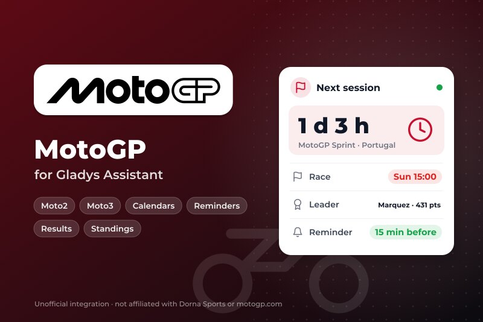
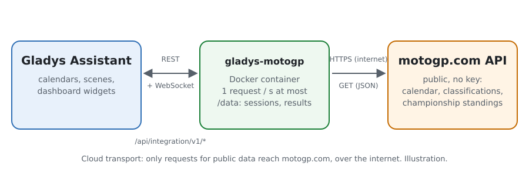
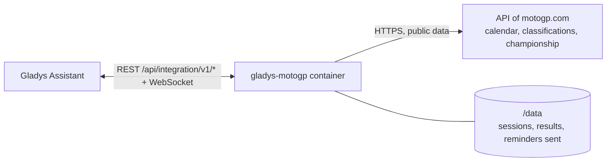
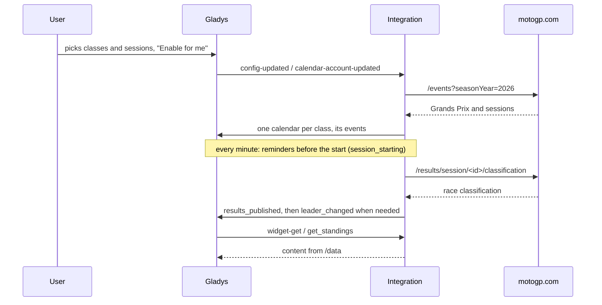
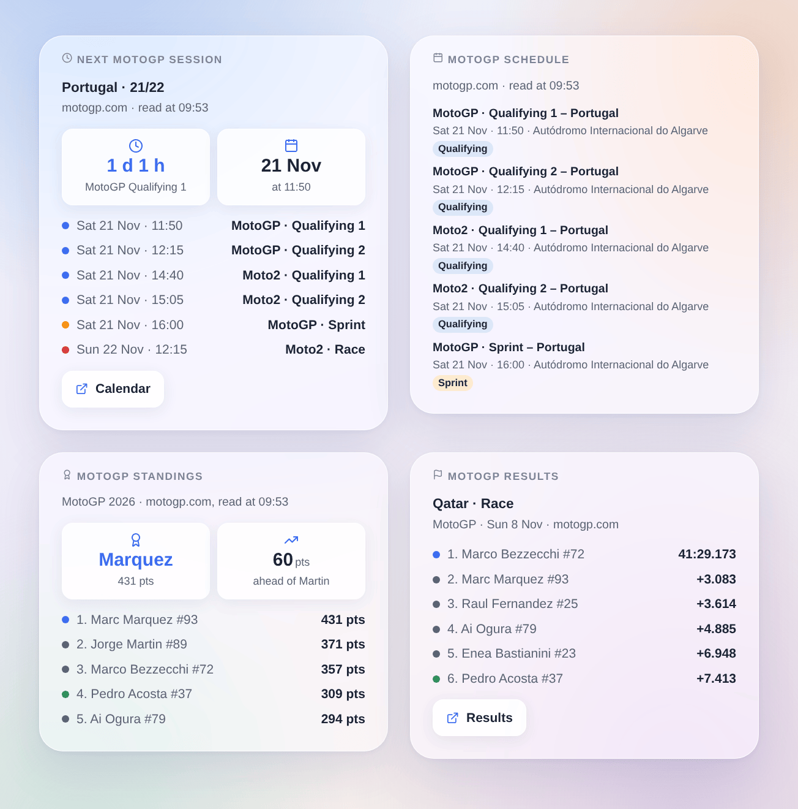

# Gladys MotoGP

**English** · [Français](README.fr.md) · [Deutsch](README.de.md) · [Español](README.es.md)

[](LICENSE)
[](https://github.com/William-De71/gladys-motogp/releases)
[](https://github.com/William-De71/gladys-motogp/actions/workflows/release.yml)
[](https://gladysassistant.com)



An external [Gladys Assistant](https://gladysassistant.com) integration to follow the **MotoGP World Championship**: the MotoGP, Moto2 and Moto3 sessions come into the Gladys calendar, with the results and the championship standings. Scenes can turn the TV on before the start or celebrate the win of your rider, and four widgets show what is coming.

User documentation: [English](docs/en.md) · [Français](docs/fr.md) · [Deutsch](docs/de.md) · [Español](docs/es.md).

> Unofficial community integration, not affiliated with, endorsed or sponsored by Dorna Sports, the FIM or motogp.com. MotoGP is a trademark of Dorna Sports.

## Features

- **4 classes** to choose from: MotoGP, Moto2, Moto3 and the Bagger World Cup (calendar only).
- **6 kinds of sessions**, each can be left out: races, sprints, qualifying, practice, warm up, tests outside Grands Prix.
- **One calendar per class** for every user who enables the integration in "My calendars", the current season and the next one, in the language of each user.
- **Results** of the races, sprints and qualifying, and the **championship standings**, with your **favorite riders** highlighted.
- **3 scene triggers**, **3 scene actions** and **4 dashboard widgets** (below).
- No account, no key. Four languages everywhere: English, French, German, Spanish.

## How it works





The data comes from the public API behind [motogp.com](https://www.motogp.com) and its official apps, without a key. The integration is gentle with it: one request at a time, one second apart, a few dozen a day.

- **Calendar**: every 6 hours, every 30 minutes during a Grand Prix weekend (times move with the weather); the next season once a day from September on.
- **Results**: of a race, a sprint or Q2, 3 minutes after the estimated end, then every 5 minutes for 3 hours, then every hour.
- **Championship**: twice a day, and right after a race or a sprint.



### Transport

Cloud only (`"transports": ["cloud"]`): the catalog shows the cloud badge. Only requests for public data (season, session, class) go to `api.motogp.pulselive.com`. Nothing about you or your home leaves your network. There is no local path, hence no "Prefer the local connection" button.

## Calendars and events

No devices: Gladys does not let one integration be both a calendar and a device integration. Each followed class is a calendar, for every user who enabled the integration.

| Item        | Content                                                                                  |
| ----------- | ---------------------------------------------------------------------------------------- |
| Calendar    | "MotoGP", "Moto2"…, color of the class, private until you share it                       |
| Event       | A session, at the time of Gladys; the end of a race is estimated (45 min, sprint 25 min) |
| Title       | "MotoGP · Sprint – Portugal", in the language of the user                                |
| Location    | Circuit, city and country                                                                |
| Description | The official name of the Grand Prix, the round, the source                               |
| Link        | The calendar of motogp.com                                                               |

The window goes from 14 days back to the end of the next season once published. In "My calendars", each user can stop the synchronization of a calendar or **share it with the household**: only a shared calendar reaches the scenes of the household and the built-in trigger "A calendar event is coming".

## Scene triggers, actions and widgets



**Scene triggers** (once per transition; the very first reading announces nothing):

- **A session starts**: at the start, or 15, 30, 60 or 120 minutes before. Filters: classes, sessions, "When".
- **Results are out**: race, sprint or qualifying (grid). Filters: classes, sessions, result of my favorite rider (wins, podium, top ten, further, not classified, absent).
- **New championship leader**. Filter: classes.

Variables: `title`, `category`, `category_name`, `session`, `session_name`, `grand_prix`, `round`, `circuit`, `date`, `time`…; `winner_name`, `winner_number`, `winner_team`, `second_name`, `third_name`, `podium`, `favorite_name`, `favorite_position`, `favorite_points`, `favorite_result`, `text` for the results; `leader_name`, `leader_points`, `gap_to_second`, `previous_leader_name` for the leader.

**Scene actions**: **next session**, **championship standings** (top three, position and gap of your favorite) and **last results** (podium, result of your favorite), each with a ready-made sentence `text`.

**Widgets**: **Next MotoGP session** (countdown, day, time and the rest of the weekend), **MotoGP schedule** (3, 5 or 8 sessions), **MotoGP standings** (leader, gap, top 5 or 10) and **MotoGP results** (last race, sprint or qualifying, with the gaps). Favorites are in green.

Examples:

- When **the MotoGP race starts in 15 minutes** → turn the TV on, dim the living room lights.
- When **the results are out** and **my favorite wins** → green lights and `{{triggerEvent.data.text}}` on Telegram.
- Every Monday at 8:00 → **championship standings**, then send `{{text}}`.

## Requirements

- Gladys Assistant **5.3.0** or later (calendar integrations; catalog keywords of Gladys 5.3). Older instances cannot install the integration.
- Internet access. No account, no key.

## Installation

- **From the Gladys store** (Integrations → External integrations), in one click, once indexed.
- **From the repository URL**: `https://github.com/William-De71/gladys-motogp`.
- **Developer mode**: build the image locally (`docker build -t gladys-motogp .`) and install it from Gladys.

## Configuration

| Field                       | Description                                                                         |
| --------------------------- | ----------------------------------------------------------------------------------- |
| Classes                     | MotoGP (default), Moto2, Moto3, Bagger World Cup. One calendar each.                |
| Sessions                    | Races, sprints and qualifying by default; practice, warm up and tests on top.       |
| Favorite riders (optional)  | Numbers or names separated by commas: "93, Bezzecchi".                              |
| Language of the scene texts | Automatic (the language of the dashboard) or a fixed one, for the `text` sentences. |

Then, in **My calendars** on the same page, press **Enable for me**: every user who wants the calendars enables the integration for themselves.

## Usage

1. Choose the classes, the sessions and your favorite riders, then save.
2. In **My calendars**, press **Enable for me**; share the calendars with the household to use them in scenes.
3. Add the widgets to a dashboard and create scenes with the triggers above.

## Development

```bash
npm install
npm test                       # node --test, never touches the network
npm run lint && npm run format:check
npx github:GladysAssistant/integration-store . --skip-image-check
scripts/build-cover.sh         # cover.jpg from docs/assets/cover.svg
docs/illustrations/render.sh   # docs/assets/widgets.<lang>.png
node .github/scripts/release.mjs next
```

Locally, the SDK reads `GLADYS_HOST_API_URL`, `GLADYS_INTEGRATION_TOKEN` and `GLADYS_INTEGRATION_SELECTOR`, and `TZ` sets the timezone of the times shown; `DEBUG=gladys-integration-sdk` prints the SDK logs and checks every widget content. The tests use real answers of motogp.com, reduced (`test/fixtures/`). The project rules are in [CLAUDE.md](CLAUDE.md).

## Release process


Every merge on `main` runs the CI, then computes the version from the [Conventional Commits](https://www.conventionalcommits.org/) since the last tag: `feat` → minor, `fix` / `perf` → patch, `!` or `BREAKING CHANGE` → major (a minor before 1.0.0); `docs`, `chore`, `ci`, `test`, `style`, `refactor`, `build` alone publish nothing. The changelog section is generated, the tag pushed, the multi-arch image built, then `main` gets the release commit, the GitHub Release is created and a last job checks the public image, the store validator and the topic.

- The title of the pull request becomes the squash commit, then the changelog line: write it in English, for the user (`pr-title.yml` checks it). Never edit `CHANGELOG.md` by hand.
- 1.0.0 is a decision: Actions → Release → Run workflow with `release-as: 1.0.0`. `dry-run` shows the version and the notes without publishing anything.
- **Protected branch**: the release pushes its commit on `main` with `GITHUB_TOKEN`. With a "require a pull request" rule on `main`, add GitHub Actions to its bypass list (or push through a GitHub App), otherwise the publish job fails and says why.
- After the first release, make the `ghcr.io` package public (Package settings → Change visibility), otherwise Gladys cannot pull it.

## Troubleshooting

See [docs/en.md](docs/en.md#troubleshooting). Report a problem with the versions of Gladys and of the integration, the followed classes and the lines of the Logs tab.

## Contributing

Issues and pull requests are welcome. Run `npm run format:check && npm run lint && npm test` before opening a pull request, and never change an external id nor a stored key (see [CLAUDE.md](CLAUDE.md)).

## Security

See [SECURITY.md](SECURITY.md): report vulnerabilities privately. The integration has no secret; it runs read-only, without root rights, in its container, and only contacts the API of motogp.com.

## Screenshots to come

The images above are illustrations, not screenshots. The real screenshots will go in `docs/assets/screenshots/` (PNG, 1280 × 800): `configuration.png`, `my-calendars.png`, `calendar.png`, `scene.png`.

## License

[Apache License 2.0](LICENSE) — see also [NOTICE](NOTICE). The data comes from [motogp.com](https://www.motogp.com): the widgets and the events name their source. Thanks to the documentation and the SDK of Gladys.
