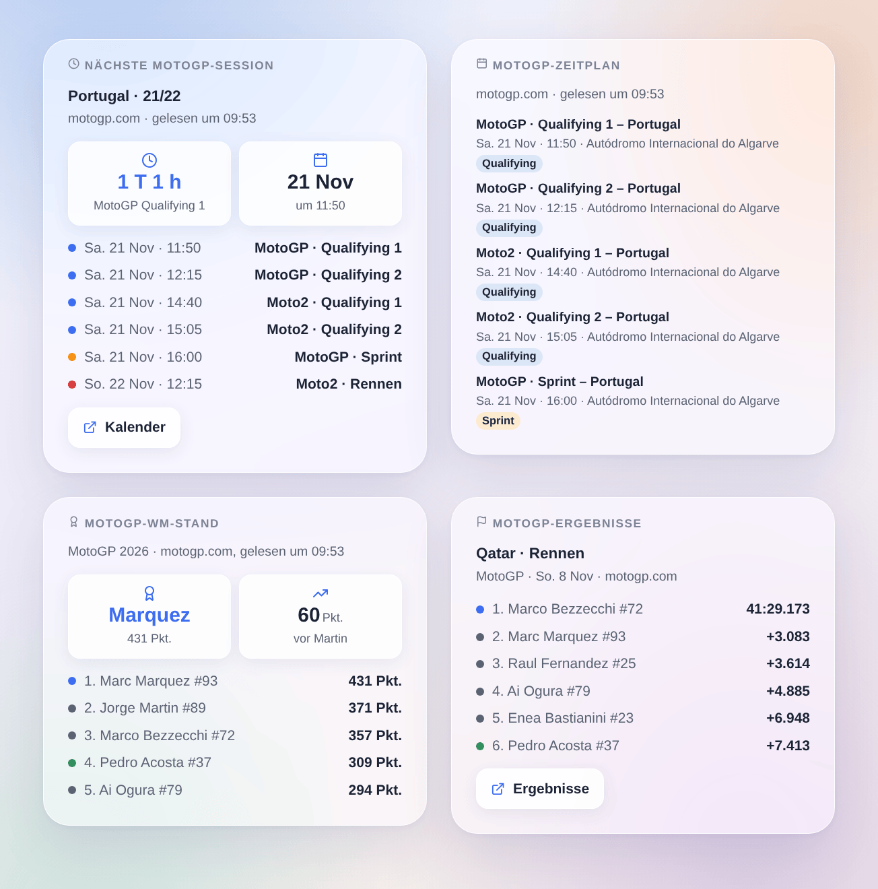

# MotoGP

## Überblick

Diese Integration bringt die **MotoGP-Weltmeisterschaft** nach Gladys: die Sessions von **MotoGP, Moto2, Moto3** und dem **Bagger World Cup**, die Ergebnisse und den WM-Stand. Jede verfolgte Klasse wird für jeden Benutzer, der die Integration aktiviert, zu einem **Kalender**. Szenen können vor dem Start einer Session, bei veröffentlichten Ergebnissen oder bei einem neuen WM-Führenden reagieren, und vier Widgets zeigen die nächste Session, den Zeitplan, den WM-Stand und die letzten Ergebnisse.

Die Daten stammen von [motogp.com](https://www.motogp.com), der offiziellen Website der Meisterschaft, die sie ohne Konto oder Schlüssel veröffentlicht. Diese Integration ist inoffiziell: Sie steht in keiner Verbindung zu Dorna Sports, der FIM oder motogp.com.

## Voraussetzungen

- Gladys Assistant **5.3.0** oder neuer (Kalender-Integrationen).
- Internetzugang. Kein Konto, kein Schlüssel.

## Konfiguration

| Feld                       | Beschreibung                                                                                                                |
| -------------------------- | --------------------------------------------------------------------------------------------------------------------------- |
| Klassen                    | MotoGP (Standard), Moto2, Moto3, Bagger World Cup. Je ein Kalender. Der Bagger World Cup hat weder Ergebnisse noch Wertung. |
| Sessions                   | Rennen, Sprints, Qualifying (Standard), Training, Warm-up, Tests außerhalb der Grands Prix.                                 |
| Lieblingsfahrer (optional) | Startnummern oder Namen, durch Kommas getrennt („93, Bezzecchi“). In den Widgets hervorgehoben, an Szenen übergeben.        |
| Sprache der Szenentexte    | Die Sprache der Sätze der Szenenauslöser und -aktionen. Automatisch: die Sprache des Dashboards.                            |

Speichern Sie und drücken Sie dann unter **Meine Kalender** auf derselben Seite auf **Für mich aktivieren**. Jeder Benutzer, der die Kalender möchte, aktiviert die Integration für sich selbst.

Eine Startnummer meint den Fahrer, der sie in jeder verfolgten Klasse trägt; ein Name (oder ein Teil davon, Akzente egal) ist genauer.

## Verwendung

### Kalender

Jede verfolgte Klasse ist ein Kalender („MotoGP“, „Moto2“ …) mit:

- einem Ereignis pro Session der gewählten Arten, zur Uhrzeit von Gladys: „MotoGP · Sprint – Portugal“. Rennen haben im offiziellen Kalender keine Endzeit: Ihr Ende wird geschätzt (45 Minuten, 25 für den Sprint);
- Strecke, Stadt und Land als Ort, dem offiziellen Namen des Grand Prix und seinem Lauf als Beschreibung;
- den Sessions von vor 14 Tagen bis zum Saisonende und der nächsten Saison, sobald motogp.com sie veröffentlicht (ab September). Eine verschobene Session folgt, eine gestrichene verschwindet.

Ein neuer Kalender ist **privat**. Unter **Meine Kalender** schalten Sie **Mit dem Haushalt teilen** ein, um ihn in den Szenen des Haushalts zu nutzen (und mit dem eingebauten Auslöser „Ein Kalenderereignis steht bevor“), oder **Diesen Kalender synchronisieren** aus, um ihn zu ignorieren. Eine aus der Konfiguration entfernte Klasse löscht ihren Kalender.

### Dashboard-Widgets

- **Nächste MotoGP-Session**: der Countdown, Tag und Uhrzeit, dann die restlichen Sessions des Wochenendes (roter Punkt: Rennen, orange: Sprint, blau: Qualifying).
- **MotoGP-Zeitplan**: die nächsten 3, 5 oder 8 Sessions mit Tag, Uhrzeit und Strecke.
- **MotoGP-WM-Stand**: der Führende, sein Vorsprung auf den Zweiten, dann die Top 5 oder 10; Ihre Lieblingsfahrer sind grün und werden unter den Top ergänzt, wenn sie nicht darin sind.
- **MotoGP-Ergebnisse**: das letzte Rennen, der letzte Sprint oder das letzte Qualifying einer Klasse mit den Abständen; Ihre Favoriten in Grün.

Die ersten beiden lassen sich in ihren Einstellungen auf bestimmte Klassen oder Sessions begrenzen; die beiden anderen zeigen eine wählbare Klasse.

### Szenen

Auslöser:

- **MotoGP: eine Session beginnt**: beim Start oder 15, 30, 60 oder 120 Minuten vorher (unter „Wann“ wählen). Filter: Klassen, Sessions.
- **MotoGP: Ergebnisse veröffentlicht**: die Wertung eines Rennens, eines Sprints oder des Qualifyings (die Startaufstellung) ist da, meist wenige Minuten nach der Zieldurchfahrt. Filter: Klassen, Sessions und **Ergebnis meines Lieblingsfahrers** (gewinnt, Zweiter oder Dritter, 4. bis 10., 11. oder dahinter, nicht gewertet, nicht in der Wertung).
- **MotoGP: neuer WM-Führender**: ein anderer Fahrer führt die Wertung einer Klasse an.

Wichtigste Variablen: `title` („MotoGP · Rennen – Qatar“), `category`, `session` (race, sprint, qualifying …), `session_name`, `grand_prix`, `round`, `circuit`, `date`, `time`; für die Ergebnisse `winner_name`, `winner_team`, `second_name`, `third_name`, `podium`, `favorite_name`, `favorite_position` (-1, wenn nicht gewertet), `favorite_points`, `favorite_result` und ein fertiger Satz `text`; für den Führenden `leader_name`, `leader_points`, `gap_to_second`, `previous_leader_name`.

Aktionen:

- **MotoGP: nächste Session**: Titel, Klasse, Session, Grand Prix, Strecke, Datum, Uhrzeit, Minuten bis zum Start und ein Satz `text`.
- **MotoGP: WM-Stand**: die ersten drei und ihre Abstände, Platz, Punkte und Rückstand Ihres Lieblingsfahrers und ein Satz `text`.
- **MotoGP: letzte Ergebnisse**: der Sieger, das Podium, das Ergebnis Ihres Favoriten und ein Satz `text`.

Beispiele:

- Wenn **das MotoGP-Rennen in 15 Minuten beginnt** → Fernseher einschalten und das Wohnzimmer dimmen.
- Wenn **die Rennergebnisse da sind** und **mein Favorit gewinnt** → die Lichter grün schalten und `{{triggerEvent.data.text}}` senden.
- Jeden Montag um 8 Uhr → **MotoGP: WM-Stand**, dann seinen `text` per Telegram senden.

Ergebnisse und ein neuer Führender lösen beim allerersten Lesen nichts aus (eine Installation am Sonntagabend meldet nicht das Rennen vom Nachmittag).

### Transport

Nur Cloud. Die Integration liest den öffentlichen Kalender, die Wertungen und die WM von motogp.com über das Internet: einige Dutzend Anfragen am Tag, etwa eine alle 30 Minuten während eines Rennwochenendes. Nichts über Sie oder Ihr Zuhause verlässt Ihr Netzwerk.

## Fehlerbehebung

- **Die Kalender bleiben leer**: Prüfen Sie, ob Sie unter Meine Kalender auf **Für mich aktivieren** gedrückt haben und ob der Status der Integration nicht meldet, dass motogp.com nicht erreichbar ist.
- **„motogp.com ist nicht erreichbar“**: Die Integration versucht es nach 15 Minuten selbst erneut; bereits Gelesenes bleibt sichtbar.
- **Keine Ergebnisse**: motogp.com veröffentlicht die Wertung wenige Minuten nach dem Ziel; die Integration fragt 3 Stunden lang alle 5 Minuten, dann stündlich. Der Bagger World Cup hat auf motogp.com keine Ergebnisse.
- **Mein Favorit wird nicht erkannt**: Schreiben Sie seinen Nachnamen wie motogp.com („Marquez“, „Viñales“ oder „Vinales“) oder seine Startnummer.
- **Die Zeiten ändern sich**: Während eines Rennwochenendes wird der Kalender alle 30 Minuten neu gelesen; verschobene Sessions folgen in den Kalendern und Erinnerungen.

Geben Sie bei einem Fehlerbericht die Versionen von Gladys und der Integration, die verfolgten Klassen und die Zeilen des Reiters Logs der Integration an; im Entwicklermodus ergänzt `DEBUG=gladys-integration-sdk` die Logs des SDK.
